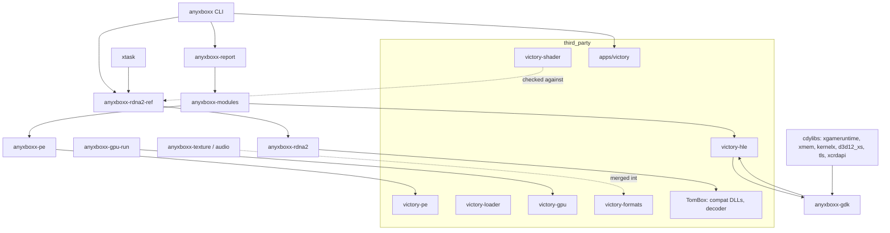

# Rust architecture: moving AnyXboxX to 100 % Rust

French version: [fr/architecture-rust.md](fr/architecture-rust.md). Keep both in sync.

**The end state contains no Python and no C++.** Every component below has a Rust destination
and a step at which the old code is deleted. Two reasons:

1. **In-game performance.** Hot paths (HLE calls, GPU translation, memory, audio) must be native
   Rust, with no Python interpreter and no C++/Python boundary in the loop. Every phase that
   touches a hot path states a measured performance goal.
2. **A cleaner codebase in one language.** One toolchain, one build (`cargo`), one test runner
   (`cargo test`), one style (`rustfmt`, `clippy`).

The Python command line (`scarlett.py`) and the pytest suite stay only as **parity oracles**
while a component is being ported: the Rust port must reproduce their outputs on the same
inputs. Once a component's Rust tests cover what its pytest tests checked, both the Python code
and those pytest tests are deleted.

## Principles

- **Reuse, do not recode.** VIctory (`third_party/victory`, our own code since #199) already runs
  the game: loader, HLE, Direct3D 12 back end, shader recompiler, formats (XMA, BCPack, texture
  tiling). It is the core. TomBox (`third_party/tombox`, submodule) provides console DLLs and an
  RDNA 2 decoder: we link to it and never edit it. AnyXboxX ports only what it has that they do
  not: GDK runtime functions, `xmem`, `kernelx` exports, the RDNA 2 reference interpreter (our
  oracle), the reports (`--rapport`, `--banc`, `jour_j.py`).
- **Parity before deletion.** A Rust port lands next to the Python or C++ code it replaces, with a
  test that runs both on the same synthetic inputs and compares the outputs. The old code is
  deleted in a later PR, once the Rust side has its own tests.
- **Repository rules still apply**: no game, console or SDK file, ever; an unimplemented function
  returns `E_NOTIMPL` (or the console's error) and is logged; every change comes with a test that
  fails without it; files under about 400 lines.
- **One PR = one component.** Each port below is its own reviewable pull request.

## Inventory (2026-11-25)

Line counts include comments and tests in the same folder (measured with a line counter on
`main` at `07d3981`).

| Component | Language | Lines | Role |
| --- | --- | ---: | --- |
| `PrototypeScarlett/emu/rdna2*.py` | Python | 10 900 | RDNA 2 decoder, operands, reference interpreter, HLSL recompiler, GPU glue |
| `PrototypeScarlett/emu/hle/` | Python | 1 400 | HLE handlers of the Unicorn sandbox (CRT, kernel, GDK, xmem) |
| `PrototypeScarlett/emu/native/` | Python | 600 | Native mode: image mapping, redirects, shims, Win32 |
| `PrototypeScarlett/emu/` (other) | Python | 1 800 | PE loader, Unicorn machine, memory, modules, reports, bench, perf, config, shader cache |
| `PrototypeScarlett/scarlett.py` | Python | 300 | Command line (`--rapport`, `--banc`, `--natif`, `--lancer`, `--rdna2`, `--carte`, `--traduction`) |
| `runtime/xgameruntime` | C++ | 3 500 | GDK runtime DLL: interfaces, saves, store, user, package, task queue, HDR, frame counter |
| `runtime/xmem` | C++ | 800 | `xmem.dll`: ERA heap, `XMemVirtualQuery` |
| `runtime/launcher`, `gpu_runner` | C++ | 950 | `anyxboxx.exe` native launcher; `anyxboxx_gpu_run.exe` (HLSL tests on GPU or WARP) |
| `runtime/kernelx`, `d3d12_xs`, `tls`, `xcrdapi`, `common` | C++ | 360 | Small DLLs: `kernelx` forwarders, `d3d12_xs` virtual memory, TLS, `XCRDAPI` |
| `runtime/third_party` | C++ | 7 700 | `Task` module of libHttpClient (MIT), the GDK task queue |
| `rust/` | Rust | 930 | `anyxboxx-rdna2` (TomBox decoder bridge), `anyxboxx-texture` (BC7, SW_4K_S), `anyxboxx-audio` (XMA2) |
| `third_party/victory` | Rust | 120 000 | VIctory: `victory-core`, `-pe`, `-loader`, `-hle`, `-gpu`, `-shader`, `-formats`, `-pipeline`, `-game`, app `victory` |
| `third_party/tombox` | Rust | submodule | TomBox console DLLs (`compat/*`), `tombox-xshader`, PE and RPF tools |
| `third_party/xbox2windows` | Python | frozen copy | Xbox2Windows' DXIL retarget |
| `tools/` | Python, PowerShell | 1 900 | Table generators, `jour_j.py`, `lancer_victory.ps1`, `Run-GpuCheck.ps1`, measurements |
| `tests/` | Python (pytest) | 1 113 tests | The oracle of every port |

`site/` (a static web page in JavaScript) is not part of the emulator and is out of scope.

## Target layout

One Cargo workspace at the repository root (`Cargo.toml`), crates in `crates/`:

| Crate | Kind | Replaces | Reuses |
| --- | --- | --- | --- |
| `anyxboxx-pe` | lib + bin | `emu/loader.py` | `victory-pe` (table parsing) |
| `anyxboxx-modules` | lib | `emu/modules.py` (DLL search, resolution, forwarders, init order) | `anyxboxx-pe`, `victory-hle` resolver |
| `anyxboxx-report` | lib | `emu/report.py`, `status_map.py`, `translation.py`, `bench.py`, `perf.py`, `tools/jour_j.py` | `anyxboxx-modules`, `victory-hle::registry` |
| `anyxboxx-gdk` | lib | logic of `runtime/xgameruntime`, `xmem`, `kernelx`, `d3d12_xs`, `tls`, `xcrdapi` | `victory-hle` modules (`xgameruntime`, `xmem`, `xasync`, `xgamesave`, `xstore`, `xuser`…) |
| `anyxboxx-xgameruntime`, `-xmem`, `-kernelx`, `-d3d12-xs`, `-tls`, `-xcrdapi` | cdylib | the C++ DLLs, same exported symbols | `anyxboxx-gdk`; built like TomBox's `compat/*` cdylibs |
| `anyxboxx-rdna2-ref` | lib | `rdna2_exec*.py`, `rdna2_operands*.py`, `rdna2_image.py`, `rdna2_buffer_format.py` | TomBox decoder via `anyxboxx-rdna2`; tables generated from LLVM |
| `anyxboxx-gpu-run` | bin | `runtime/gpu_runner` | `victory-gpu` device code, `windows` crate |
| `anyxboxx-texture`, `anyxboxx-audio`, `anyxboxx-rdna2` | lib + bin | move from `rust/` | then merged into `victory-formats` where it already covers the format |
| `anyxboxx` | bin | `scarlett.py`, the former `anyxboxx run` | `clap`, all of the above, `apps/victory` for running the game |
| `xtask` | bin | `tools/*.py` generators and checks | the same LLVM test files (downloaded locally, never committed) |

What is **not** ported, because VIctory already does it: the HLSL recompiler (`rdna2_hlsl*.py`,
replaced by `victory-shader`'s DXIL path once coverage matches), the Unicorn sandbox (see
decision D2) and the DXIL retarget (deleted with Python).

`victory-hle` and `anyxboxx-gdk` point at each other on purpose: `anyxboxx-gdk` starts as a client
of `victory-hle` (it reuses its modules), and VIctory's modules then call `anyxboxx-gdk` for the
functions AnyXboxX implements better (saves, store, HDR luminance). To avoid a dependency cycle,
the shared code lives in `anyxboxx-gdk` and the `victory-hle` modules become thin adapters over
it (decision D3).

## Workspace decisions

- **Excluded trees.** The root workspace excludes `rust/`, `third_party/` and `.claude/`. Cargo
  refuses a package claimed by two workspaces, and a package excluded by its own workspace
  (VIctory's `tests/fixtures`) climbs up to the next one. Excluding these trees keeps
  `cargo build --manifest-path rust/Cargo.toml`, VIctory's build and policy check, and TomBox's
  build unchanged. Claude Code worktrees in `.claude/worktrees` hold full checkouts, hence the
  third exclusion.
- **VIctory by path, not as members.** Our crates depend on `third_party/victory/crates/*` by
  path. VIctory keeps its own workspace, toolchain pin (`rust-toolchain.toml`, 1.98.1) and lints.
  The root workspace sets `rust-version = 1.88`, VIctory's minimum.
- **`rust/` merges into `crates/`** in phase 1; `rust/Cargo.toml` is then deleted.
- **One target directory**, `target/` at the root (ignored by git).

## Parity method

- Each port ships a small command line (`anyxboxx-pe <image> [--base] [--pages]`, later the
  `anyxboxx` subcommands) that prints the result as JSON.
- A pytest test runs the Python code and the Rust binary on the **same inputs built from source**
  (`tests/pe_builder.py`, the RDNA 2 encoders of `tests/test_rdna2_exec*.py`) and compares the
  JSON. Refusals must match too: both accept or both refuse. In CI (`ANYXBOXX_REQUIRE_RUNTIME=1`)
  a missing binary fails the test; locally it is skipped.
- The Rust crate has its own `cargo test` suite, built from the same kind of synthetic inputs
  (`crates/anyxboxx-pe/tests/common` is the Rust twin of `pe_builder.py`). It takes over when
  the Python code is deleted.
- **RDNA 2** keeps its two oracles: the decoder is checked against LLVM's encoding tests
  (`--verifier`), and every translation is checked byte for byte against the reference
  interpreter, on GPU or WARP. The Rust interpreter is first checked against the Python one on
  every test program, then replaces it as the oracle of `victory-shader`.
- **C++ DLLs**: the existing pytest tests (`test_runtime_*.py`, `test_xmem_*.py`,
  `test_kernelx.py`, `test_native*.py`) load the DLLs by name from `ANYXBOXX_RUNTIME`. Pointing
  that variable at the Rust cdylibs runs the same tests unchanged against the port.

## Phases

Each phase is several pull requests. A phase is done when every box is ticked.

### Phase 0: foundation (this PR)

- [x] Root `Cargo.toml` workspace, `crates/`, `target/` ignored; existing workspaces unchanged.
- [x] `anyxboxx-pe`: Rust port of `emu/loader.read_pe` on top of `victory-pe`.
- [x] Parity harness: `tests/test_rust_pe_parity.py` (13 images, page protections included).
- [x] CI builds and tests the root workspace before pytest.

### Phase 1: one Rust workspace

- [ ] Move `rust/anyxboxx-*` into `crates/`, delete `rust/Cargo.toml`; update the binary paths in
      `tests/test_textures.py`, `test_audio.py`, `test_tombox_bridge.py`.
- [ ] Compare `anyxboxx-texture` and `anyxboxx-audio` with `victory-formats` (BC7, SW_4K_S, XMA2)
      on the same inputs; keep one implementation, in `victory-formats`, delete the other.
- [ ] CI runs `cargo build`, `cargo test`, `cargo clippy` once for the root workspace.

Done when: no `Cargo.toml` outside the root, `crates/` and `third_party/`.

### Phase 2: loader, modules and reports

- [ ] `anyxboxx-modules` (port of `modules.py`), parity on the multi-DLL cases of `test_modules.py`.
- [x] `anyxboxx-report` and the `anyxboxx` CLI (on `rust/full`; RDNA 2 numbers from a data table until phase 4): `rapport`, `banc`, `jour-j`, `carte`, `traduction`
      (the README SVG generators), parity on `test_review.py`, `test_status_map.py`,
      `test_jour_j.py`, `test_translation.py`.
- [ ] `scarlett.py --rapport` and `tools/jour_j.py` become thin wrappers that call the Rust binary,
      then are deleted.

Done when: `emu/loader.py`, `modules.py`, `report.py`, `status_map.py`, `translation.py`,
`tools/jour_j.py` are deleted.

### Phase 3: GDK runtime in Rust (hot path)

- [ ] `anyxboxx-gdk` gathers the logic of `runtime/xgameruntime` (interfaces table from
      `gdk_api_table.inc`, saves, store, user, package, gamer picture, HDR luminance, frame
      counter), `xmem` (ERA heap, virtual query), `kernelx`, `d3d12_xs`, `tls`, `xcrdapi`.
      The GDK task queue reuses `victory-hle`'s `xasync` instead of libHttpClient's `Task`.
- [ ] cdylib crates export the same symbols as the `.def` files; `tools/kernelx_exports.py`
      and `gdk_interfaces.py` move to `xtask` and generate the Rust export tables.
- [x] The runtime pytest tests pass with `ANYXBOXX_RUNTIME` pointing at the Rust DLLs.
- [ ] `victory-hle` modules call `anyxboxx-gdk` where AnyXboxX had the better behaviour.
- [ ] **Perf goal:** with the former `anyxboxx run` and the frame counter
      (`ANYXBOXX_FPS_CSV`, `emu/perf.py`), average frame time and 1 % low over the same scene
      are not worse than before the switch, measured twice (cache warm), card and driver noted.
      HLE call overhead (calls per frame × time per call, from the diagnostics build) is
      reported in the PR.

Done when: `runtime/` (C++, CMake, `third_party/libhttpclient-task`) is deleted and CI no
longer installs a C++ toolchain.

### Phase 4: RDNA 2 in Rust (hot path for shader translation)

- [ ] `xtask rdna2-tables` generates the opcode and shape tables from LLVM's `.s` files, like
      `tools/rdna2_mnemonics.py` and `rdna2_shapes.py` do today; `--verifier` is ported too.
- [ ] `anyxboxx-rdna2-ref`: reference interpreter (SOP/VOP/VOP3/VOP3P, SDWA/DPP, SMEM,
      MUBUF/MTBUF, FLAT, MIMG, EXP, wave32/wave64), parity with `rdna2_exec*.py` on every
      program of the `test_rdna2_exec*.py` encoders: same registers and memory, bit for bit.
- [ ] `anyxboxx-gpu-run` replaces `runtime/gpu_runner`; the byte-for-byte checks run
      `victory-shader` output against the Rust interpreter.
- [ ] `rdna2_hlsl*.py` retired once `victory-shader` covers the same instructions
      (`rdna2_coverage.py` counts, then its Rust port).
- [ ] **Perf goal:** translation time per pipeline and first-frame stall measured with the
      `translate --cache --pipelines` step of the former `anyxboxx run`; no regression,
      and the Python interpreter is out of every measured path.

Done when: `PrototypeScarlett/emu/rdna2*.py`, `third_party/xbox2windows`
are deleted.

### Phase 5: isolated mode and remaining HLE

- [ ] Decision D2 taken. Then either a Rust sandbox crate or removal of the isolated mode.
- [ ] Python HLE handlers (`emu/hle/`) not already covered by `victory-hle` are ported into it,
      each with its test.

### Phase 6: tools and removal of Python

- [ ] `xtask` takes the remaining tools (`compare_tombox`, `sync_voisins`, `veille`,
      `fssm_mesure`, `sonde_compilateur_xbox`, `build_tombox`, `Run-GpuCheck.ps1`);
      `lancer_victory.ps1` becomes `anyxboxx run`.
- [ ] Every pytest test has a Rust counterpart; `PrototypeScarlett/`, `tests/*.py`,
      `requirements*.txt`, `pytest.ini` are deleted; the README test count comes from
      `cargo test`; CI is cargo only.
- [ ] **Perf goal:** the full game run (`anyxboxx run`) holds the frame time of the best
      measurement of phases 3 and 4, on the same machine and scene.

Done when: `git ls-files '*.py' '*.cpp' '*.h' '*.ps1'` lists nothing outside `third_party/tombox`.

## Risks and decisions for the maintainer

**Decisions taken on 2026-11-25** (by the lead, for the maintainer, after review of #211):

- **D2: the isolated Unicorn mode is dropped** from the end state. Python + Unicorn stay only as a
  temporary parity oracle and are deleted with Python in phase 6; no Rust sandbox is written.
- **D3: AnyXboxX's GDK logic goes into `victory-hle` modules.** No separate `anyxboxx-gdk` crate,
  unless a cdylib needs code shared with VIctory; then only that code moves to a small crate.
- **D4: one launcher.** `apps/victory`, driven by `anyxboxx run` (which replaces
  the former `anyxboxx run`); `anyxboxx.exe` is deleted in phase 3.
- **Toolchain: the root pins Rust 1.98.1**, the same as VIctory (`rust-toolchain.toml`).

The paragraphs below keep the options as they were weighed.

- **D1. The C++ DLLs become Rust cdylibs.** Rust can export the same unmangled symbols
  (`#[unsafe(no_mangle)] extern "system"`) and COM-like vtables, as TomBox's `compat/*` crates
  already do. Real blockers to check per DLL: exports by ordinal only (need a `.def` file passed
  to the linker, supported by `cargo:rustc-link-arg`), TLS callbacks in `anyxboxx_tls` (Rust
  supports `.CRT$XL*` sections with `#[link_section]`), and C++ exceptions crossing the boundary
  (none expected: GDK functions return HRESULTs). None looks blocking today.
- **D2. The Unicorn sandbox (isolated mode).** Unicorn 2 is GPL-2.0; linking it into a
  GPL-3.0-or-later Rust binary needs a licence check. Options: keep a Rust sandbox with
  `unicorn-engine` if compatible, write a minimal x86-64 interpreter for HLE tests, or drop the
  isolated mode and rely on native mode (VIctory loader) plus unit tests. Recommendation: drop it,
  since VIctory's native loader is what runs the game.
- **D3. Where AnyXboxX's GDK logic lives.** Either inside `victory-hle` modules (one runtime, in
  VIctory's process) or in `anyxboxx-gdk` shared by `victory-hle` and the cdylibs. The second
  keeps the DLLs usable outside VIctory; the first is simpler. A choice is needed before phase 3.
- **D4. Two launchers.** `anyxboxx.exe` (C++ native launcher) and `apps/victory`. Recommendation:
  one launcher, `apps/victory`, called by `anyxboxx run`; `anyxboxx.exe` deleted in phase 3.
- **D5. Parity oracles are temporary.** Deleting a pytest test before its Rust twin exists loses
  coverage silently. Rule: a pytest file is deleted only in the PR that adds the Rust tests
  covering the same cases, with the test count in the README updated.
- **Toolchain.** VIctory pins 1.98.1; the root uses whatever `stable` is installed (minimum
  1.88). If the root should pin too, add a `rust-toolchain.toml` at the root and check that CI's
  `rust/` and TomBox builds still use a compatible version.
- **Ported behaviour differences.** `anyxboxx-pe` refuses relocation types other than ABSOLUTE,
  HIGHLOW and DIR64 (pefile also applied HIGH, LOW and HIGHADJ, which x86-64 images do not use),
  a malformed relocation block (pefile dropped the rest of the table with a warning), and a
  section whose raw data lies outside the file (pefile skipped it silently). Bounds of the
  TLS checks use `SizeOfImage`, where the Python loader used the length of pefile's mapped image.
  These only concern malformed images; the stricter behaviour follows rule 3 (no fake success).

## Status

Phase 0 done in the pull request "refactor: Rust architecture plan and first ported component".

The native runtime now loads all six Rust DLLs. Three C++ targets supply the parity tests. The [runtime inventory](rust-full-status.md#windows-x64-xgameruntime-inventory) lists the shared GDK data files, tested interfaces and build commands.
