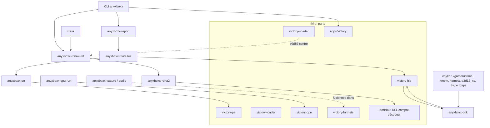

# Architecture Rust : passer AnyXboxX à 100 % Rust

Version anglaise : [../architecture-rust.md](../architecture-rust.md). Les deux restent synchronisées.

**L'état final ne contient ni Python ni C++.** Chaque composant ci-dessous a une destination
en Rust et une étape où l'ancien code est supprimé. Deux raisons :

1. **Les performances en jeu.** Les chemins chauds (appels HLE, traduction GPU, mémoire, son)
   doivent être en Rust natif, sans interpréteur Python ni frontière C++/Python dans la boucle.
   Chaque phase qui touche un chemin chaud fixe un objectif de performance mesuré.
2. **Un code plus propre, dans une seule langue.** Une chaîne d'outils, une compilation
   (`cargo`), un lanceur de tests (`cargo test`), un style (`rustfmt`, `clippy`).

La ligne de commande Python (`scarlett.py`) et la suite pytest ne restent que comme **oracles de
parité** pendant le portage d'un composant : le portage Rust doit reproduire leurs sorties sur
les mêmes entrées. Quand les tests Rust d'un composant couvrent ce que vérifiaient ses tests
pytest, le code Python et ces tests pytest sont supprimés.

## Principes

- **Réutiliser, ne pas recoder.** VIctory (`third_party/victory`, notre code depuis #199) fait
  déjà tourner le jeu : chargeur, HLE, rendu Direct3D 12, recompilateur de shaders, formats (XMA,
  BCPack, agencement des textures). C'est le cœur. TomBox (`third_party/tombox`, sous-module)
  fournit des DLL console et un décodeur RDNA 2 : on s'y lie sans jamais le modifier. AnyXboxX ne
  porte que ce qu'il a et qu'eux n'ont pas : fonctions du runtime GDK, `xmem`, exports de
  `kernelx`, interpréteur de référence RDNA 2 (notre oracle), rapports (`--rapport`, `--banc`,
  `jour_j.py`).
- **La parité avant la suppression.** Un portage Rust arrive à côté du code Python ou C++ qu'il
  remplace, avec un test qui lance les deux sur les mêmes entrées synthétiques et compare les
  sorties. L'ancien code est supprimé dans une PR suivante, quand le côté Rust a ses propres tests.
- **Les règles du dépôt restent valables** : jamais de fichier du jeu, de la console ou du SDK ;
  une fonction non implémentée renvoie `E_NOTIMPL` (ou l'erreur de la console) et est journalisée ;
  chaque changement vient avec un test qui échoue sans lui ; des fichiers d'environ 400 lignes au
  plus.
- **Une PR = un composant.** Chaque portage ci-dessous est une pull request relisible à part.

## Inventaire (25/11/2026)

Les nombres de lignes comprennent commentaires et tests du même dossier (mesurés avec un
compteur de lignes sur `main` à `07d3981`).

| Composant | Langage | Lignes | Rôle |
| --- | --- | ---: | --- |
| `PrototypeScarlett/emu/rdna2*.py` | Python | 10 900 | Décodeur RDNA 2, opérandes, interpréteur de référence, recompilateur HLSL, liaison GPU |
| `PrototypeScarlett/emu/hle/` | Python | 1 400 | Fonctions HLE du bac à sable Unicorn (CRT, noyau, GDK, xmem) |
| `PrototypeScarlett/emu/native/` | Python | 600 | Mode natif : placement de l'image, redirections, cales, Win32 |
| `PrototypeScarlett/emu/` (reste) | Python | 1 800 | Chargeur PE, machine Unicorn, mémoire, modules, rapports, banc, perf, config, cache de shaders |
| `PrototypeScarlett/scarlett.py` | Python | 300 | Ligne de commande (`--rapport`, `--banc`, `--natif`, `--lancer`, `--rdna2`, `--carte`, `--traduction`) |
| `runtime/xgameruntime` | C++ | 3 500 | DLL du runtime GDK : interfaces, sauvegardes, boutique, utilisateur, paquet, file de tâches, HDR, compteur d'images |
| `runtime/xmem` | C++ | 800 | `xmem.dll` : tas ERA, `XMemVirtualQuery` |
| `runtime/launcher`, `gpu_runner` | C++ | 950 | Lanceur natif `anyxboxx.exe` ; `anyxboxx_gpu_run.exe` (tests HLSL sur GPU ou WARP) |
| `runtime/kernelx`, `d3d12_xs`, `tls`, `xcrdapi`, `common` | C++ | 360 | Petites DLL : redirections de `kernelx`, mémoire virtuelle de `d3d12_xs`, TLS, `XCRDAPI` |
| `runtime/third_party` | C++ | 7 700 | Module `Task` de libHttpClient (MIT), la file de tâches GDK |
| `rust/` | Rust | 930 | `anyxboxx-rdna2` (passerelle vers le décodeur de TomBox), `anyxboxx-texture` (BC7, SW_4K_S), `anyxboxx-audio` (XMA2) |
| `third_party/victory` | Rust | 120 000 | VIctory : `victory-core`, `-pe`, `-loader`, `-hle`, `-gpu`, `-shader`, `-formats`, `-pipeline`, `-game`, application `victory` |
| `third_party/tombox` | Rust | sous-module | DLL console de TomBox (`compat/*`), `tombox-xshader`, outils PE et RPF |
| `third_party/xbox2windows` | Python | copie figée | Retarget DXIL de Xbox2Windows |
| `tools/` | Python, PowerShell | 1 900 | Générateurs de tables, `jour_j.py`, `lancer_victory.ps1`, `Run-GpuCheck.ps1`, mesures |
| `tests/` | Python (pytest) | 1 113 tests | L'oracle de chaque portage |

`site/` (une page web statique en JavaScript) ne fait pas partie de l'émulateur et reste hors
du périmètre.

## Organisation cible

Un seul espace Cargo à la racine du dépôt (`Cargo.toml`), les crates dans `crates/` :

| Crate | Type | Remplace | Réutilise |
| --- | --- | --- | --- |
| `anyxboxx-pe` | lib + bin | `emu/loader.py` | `victory-pe` (lecture des tables) |
| `anyxboxx-modules` | lib | `emu/modules.py` (recherche des DLL, résolution, redirections, ordre d'initialisation) | `anyxboxx-pe`, résolveur de `victory-hle` |
| `anyxboxx-report` | lib | `emu/report.py`, `status_map.py`, `translation.py`, `bench.py`, `perf.py`, `tools/jour_j.py` | `anyxboxx-modules`, `victory-hle::registry` |
| `anyxboxx-gdk` | lib | logique de `runtime/xgameruntime`, `xmem`, `kernelx`, `d3d12_xs`, `tls`, `xcrdapi` | modules de `victory-hle` (`xgameruntime`, `xmem`, `xasync`, `xgamesave`, `xstore`, `xuser`…) |
| `anyxboxx-xgameruntime`, `-xmem`, `-kernelx`, `-d3d12-xs`, `-tls`, `-xcrdapi` | cdylib | les DLL C++, mêmes symboles exportés | `anyxboxx-gdk` ; compilées comme les cdylib `compat/*` de TomBox |
| `anyxboxx-rdna2-ref` | lib | `rdna2_exec*.py`, `rdna2_operands*.py`, `rdna2_image.py`, `rdna2_buffer_format.py` | décodeur de TomBox via `anyxboxx-rdna2` ; tables générées depuis LLVM |
| `anyxboxx-gpu-run` | bin | `runtime/gpu_runner` | code de périphérique de `victory-gpu`, crate `windows` |
| `anyxboxx-texture`, `anyxboxx-audio`, `anyxboxx-rdna2` | lib + bin | quittent `rust/` | puis fusion dans `victory-formats` là où il couvre déjà le format |
| `anyxboxx` | bin | `scarlett.py`, l'ancien `anyxboxx run` | `clap`, tout ce qui précède, `apps/victory` pour lancer le jeu |
| `xtask` | bin | générateurs et vérifications de `tools/*.py` | les mêmes fichiers de test de LLVM (téléchargés en local, jamais committés) |

Ce qui **n'est pas** porté, parce que VIctory le fait déjà : le recompilateur HLSL
(`rdna2_hlsl*.py`, remplacé par le chemin DXIL de `victory-shader` quand la couverture est
égale), le bac à sable Unicorn (voir la décision D2) et le retarget DXIL (supprimé avec
Python).

`victory-hle` et `anyxboxx-gdk` pointent l'un vers l'autre exprès : `anyxboxx-gdk` commence comme
client de `victory-hle` (il réutilise ses modules), puis les modules de VIctory appellent
`anyxboxx-gdk` pour les fonctions qu'AnyXboxX implémente mieux (sauvegardes, boutique, luminance
HDR). Pour éviter un cycle de dépendances, le code partagé vit dans `anyxboxx-gdk` et les modules
de `victory-hle` deviennent de fins adaptateurs (décision D3).

## Choix de l'espace Cargo

- **Arborescences exclues.** L'espace racine exclut `rust/`, `third_party/` et `.claude/`. Cargo
  refuse un paquet revendiqué par deux espaces, et un paquet exclu par son propre espace (les
  `tests/fixtures` de VIctory) remonte jusqu'au suivant. Les exclure laisse intacts
  `cargo build --manifest-path rust/Cargo.toml`, la compilation et la vérification de politique de
  VIctory, et la compilation de TomBox. Les worktrees de Claude Code dans `.claude/worktrees`
  contiennent des copies complètes du dépôt, d'où la troisième exclusion.
- **VIctory par chemin, pas comme membre.** Nos crates dépendent de
  `third_party/victory/crates/*` par chemin. VIctory garde son espace, sa version de Rust épinglée
  (`rust-toolchain.toml`, 1.98.1) et ses lints. L'espace racine fixe `rust-version = 1.88`, le
  minimum de VIctory.
- **`rust/` rejoint `crates/`** en phase 1 ; `rust/Cargo.toml` est alors supprimé.
- **Un seul dossier de compilation**, `target/` à la racine (ignoré par git).

## Méthode de parité

- Chaque portage fournit une petite ligne de commande (`anyxboxx-pe <image> [--base] [--pages]`,
  plus tard les sous-commandes d'`anyxboxx`) qui écrit son résultat en JSON.
- Un test pytest lance le code Python et le binaire Rust sur **les mêmes entrées fabriquées à
  partir de sources** (`tests/pe_builder.py`, les encodeurs RDNA 2 de `tests/test_rdna2_exec*.py`)
  et compare les JSON. Les refus doivent aussi correspondre : les deux acceptent ou les deux
  refusent. En CI (`ANYXBOXX_REQUIRE_RUNTIME=1`), un binaire absent fait échouer le test ; en
  local, il est ignoré.
- La crate Rust a sa propre suite `cargo test`, construite avec le même genre d'entrées
  synthétiques (`crates/anyxboxx-pe/tests/common` est le jumeau Rust de `pe_builder.py`). Elle
  prend le relais quand le code Python est supprimé.
- **RDNA 2** garde ses deux oracles : le décodeur est vérifié contre les tests d'encodage de LLVM
  (`--verifier`), et chaque traduction est vérifiée octet par octet contre l'interpréteur de
  référence, sur GPU ou WARP. L'interpréteur Rust est d'abord comparé à l'interpréteur Python sur
  chaque programme de test, puis le remplace comme oracle de `victory-shader`.
- **DLL C++** : les tests pytest existants (`test_runtime_*.py`, `test_xmem_*.py`,
  `test_kernelx.py`, `test_native*.py`) chargent les DLL par leur nom depuis `ANYXBOXX_RUNTIME`.
  Faire pointer cette variable vers les cdylib Rust lance les mêmes tests, inchangés, contre le
  portage.

## Phases

Chaque phase compte plusieurs pull requests. Une phase est finie quand toutes ses cases sont
cochées.

### Phase 0 : fondations (cette PR)

- [x] Espace Cargo racine `Cargo.toml`, `crates/`, `target/` ignoré ; espaces existants inchangés.
- [x] `anyxboxx-pe` : portage Rust de `emu/loader.read_pe` sur `victory-pe`.
- [x] Banc de parité : `tests/test_rust_pe_parity.py` (13 images, protections des pages comprises).
- [x] La CI compile et teste l'espace racine avant pytest.

### Phase 1 : un seul espace Rust

- [ ] Déplacer `rust/anyxboxx-*` dans `crates/`, supprimer `rust/Cargo.toml` ; mettre à jour les
      chemins des binaires dans `tests/test_textures.py`, `test_audio.py`, `test_tombox_bridge.py`.
- [ ] Comparer `anyxboxx-texture` et `anyxboxx-audio` à `victory-formats` (BC7, SW_4K_S, XMA2) sur
      les mêmes entrées ; garder une seule implémentation, dans `victory-formats`, supprimer l'autre.
- [ ] La CI lance `cargo build`, `cargo test`, `cargo clippy` une seule fois pour l'espace racine.

Finie quand : aucun `Cargo.toml` hors de la racine, de `crates/` et de `third_party/`.

### Phase 2 : chargeur, modules et rapports

- [ ] `anyxboxx-modules` (portage de `modules.py`), parité sur les cas à plusieurs DLL de
      `test_modules.py`.
- [x] `anyxboxx-report` et la CLI `anyxboxx` (sur `rust/full` ; chiffres RDNA 2 lus dans une table jusqu'à la phase 4) : `rapport`, `banc`, `jour-j`, `carte`, `traduction`
      (les générateurs des SVG du README), parité sur `test_review.py`, `test_status_map.py`,
      `test_jour_j.py`, `test_translation.py`.
- [ ] `scarlett.py --rapport` et `tools/jour_j.py` deviennent de fines enveloppes qui appellent le
      binaire Rust, puis sont supprimés.

Finie quand : `emu/loader.py`, `modules.py`, `report.py`, `status_map.py`, `translation.py`,
`tools/jour_j.py` sont supprimés.

### Phase 3 : runtime GDK en Rust (chemin chaud)

- [ ] `anyxboxx-gdk` réunit la logique de `runtime/xgameruntime` (table des interfaces de
      `gdk_api_table.inc`, sauvegardes, boutique, utilisateur, paquet, image du joueur, luminance
      HDR, compteur d'images), de `xmem` (tas ERA, requête de mémoire virtuelle), `kernelx`,
      `d3d12_xs`, `tls`, `xcrdapi`. La file de tâches GDK réutilise `xasync` de `victory-hle` au
      lieu du module `Task` de libHttpClient.
- [ ] Des crates cdylib exportent les mêmes symboles que les fichiers `.def` ;
      `tools/kernelx_exports.py` et `gdk_interfaces.py` passent dans `xtask` et génèrent les
      tables d'exports Rust.
- [x] Les tests pytest du runtime passent avec `ANYXBOXX_RUNTIME` pointant vers les DLL Rust.
- [ ] Les modules de `victory-hle` appellent `anyxboxx-gdk` là où AnyXboxX avait le meilleur
      comportement.
- [ ] **Objectif de performance :** avec l'ancien `anyxboxx run` et le compteur d'images
      (`ANYXBOXX_FPS_CSV`, `emu/perf.py`), le temps moyen par image et le 1 % bas sur la même scène
      ne sont pas pires qu'avant la bascule, mesurés deux fois (cache chaud), carte et pilote
      notés. Le coût des appels HLE (appels par image × durée d'un appel, d'après le build de
      diagnostic) figure dans la PR.

Finie quand : `runtime/` (C++, CMake, `third_party/libhttpclient-task`) est supprimé et la CI
n'installe plus de chaîne C++.

### Phase 4 : RDNA 2 en Rust (chemin chaud de la traduction des shaders)

- [ ] `xtask rdna2-tables` génère les tables d'opcodes et de formes depuis les fichiers `.s` de
      LLVM, comme `tools/rdna2_mnemonics.py` et `rdna2_shapes.py` aujourd'hui ; `--verifier` est
      porté aussi.
- [ ] `anyxboxx-rdna2-ref` : interpréteur de référence (SOP/VOP/VOP3/VOP3P, SDWA/DPP, SMEM,
      MUBUF/MTBUF, FLAT, MIMG, EXP, wave32/wave64), parité avec `rdna2_exec*.py` sur chaque
      programme des encodeurs de `test_rdna2_exec*.py` : mêmes registres et même mémoire, bit pour
      bit.
- [ ] `anyxboxx-gpu-run` remplace `runtime/gpu_runner` ; les vérifications octet par octet
      comparent la sortie de `victory-shader` à l'interpréteur Rust.
- [ ] `rdna2_hlsl*.py` est retiré quand `victory-shader` couvre les mêmes instructions (comptes de
      `rdna2_coverage.py`, puis de son portage Rust).
- [ ] **Objectif de performance :** temps de traduction par pipeline et blocage de la première
      image mesurés avec l'étape `translate --cache --pipelines` de l'ancien `anyxboxx run` ;
      aucune régression, et l'interpréteur Python ne figure dans aucun chemin mesuré.

Finie quand : `PrototypeScarlett/emu/rdna2*.py`, `third_party/xbox2windows`
sont supprimés.

### Phase 5 : mode isolé et HLE restant

- [ ] Décision D2 prise. Puis soit une crate de bac à sable en Rust, soit la suppression du mode
      isolé.
- [ ] Les fonctions HLE Python (`emu/hle/`) que `victory-hle` ne couvre pas encore y sont portées,
      chacune avec son test.

### Phase 6 : outils et suppression de Python

- [ ] `xtask` reprend les derniers outils (`compare_tombox`, `sync_voisins`, `veille`,
      `fssm_mesure`, `sonde_compilateur_xbox`, `build_tombox`, `Run-GpuCheck.ps1`) ;
      `lancer_victory.ps1` devient `anyxboxx run`.
- [ ] Chaque test pytest a son équivalent Rust ; `PrototypeScarlett/`, `tests/*.py`,
      `requirements*.txt`, `pytest.ini` sont supprimés ; le nombre de tests du README vient de
      `cargo test` ; la CI n'utilise plus que cargo.
- [ ] **Objectif de performance :** le jeu complet (`anyxboxx run`) tient le temps par image de la
      meilleure mesure des phases 3 et 4, sur la même machine et la même scène.

Finie quand : `git ls-files '*.py' '*.cpp' '*.h' '*.ps1'` ne liste rien hors de `third_party/tombox`.

## Risques et décisions pour le mainteneur

**Décisions prises le 25/11/2026** (par le lead, pour le mainteneur, après la relecture de #211) :

- **D2 : le mode isolé Unicorn est abandonné** dans l'état final. Python + Unicorn ne restent que
  comme oracle de parité temporaire et partent avec Python en phase 6 ; aucun bac à sable Rust
  n'est écrit.
- **D3 : la logique GDK d'AnyXboxX va dans les modules de `victory-hle`.** Pas de crate
  `anyxboxx-gdk` séparée, sauf si une cdylib a besoin de code partagé avec VIctory ; seul ce code
  passe alors dans une petite crate.
- **D4 : un seul lanceur.** `apps/victory`, piloté par `anyxboxx run` (qui remplace
  l'ancien `anyxboxx run`) ; `anyxboxx.exe` est supprimé en phase 3.
- **Chaîne d'outils : la racine épingle Rust 1.98.1**, comme VIctory (`rust-toolchain.toml`).

Les paragraphes ci-dessous gardent les options telles qu'elles ont été pesées.

- **D1. Les DLL C++ deviennent des cdylib Rust.** Rust peut exporter les mêmes symboles non
  décorés (`#[unsafe(no_mangle)] extern "system"`) et des vtables de type COM, comme le font déjà
  les crates `compat/*` de TomBox. Vrais obstacles à vérifier pour chaque DLL : exports par ordinal
  seulement (il faut passer un `.def` à l'éditeur de liens, possible avec
  `cargo:rustc-link-arg`), callbacks TLS dans `anyxboxx_tls` (Rust gère les sections `.CRT$XL*`
  avec `#[link_section]`), et exceptions C++ qui traversent la frontière (aucune attendue : les
  fonctions GDK renvoient des HRESULT). Rien ne semble bloquant aujourd'hui.
- **D2. Le bac à sable Unicorn (mode isolé).** Unicorn 2 est sous GPL-2.0 ; le lier à un binaire
  Rust en GPL-3.0 ou ultérieure demande une vérification de licence. Options : garder un bac à
  sable Rust avec `unicorn-engine` si c'est compatible, écrire un interpréteur x86-64 minimal pour
  les tests HLE, ou abandonner le mode isolé et s'appuyer sur le mode natif (chargeur de VIctory)
  et des tests unitaires. Recommandation : l'abandonner, puisque c'est le chargeur natif de VIctory
  qui fait tourner le jeu.
- **D3. Où vit la logique GDK d'AnyXboxX.** Soit dans les modules de `victory-hle` (un seul
  runtime, dans le processus de VIctory), soit dans `anyxboxx-gdk`, partagé par `victory-hle` et
  les cdylib. Le second garde les DLL utilisables hors de VIctory ; le premier est plus simple. Il
  faut choisir avant la phase 3.
- **D4. Deux lanceurs.** `anyxboxx.exe` (lanceur natif C++) et `apps/victory`. Recommandation : un
  seul lanceur, `apps/victory`, appelé par `anyxboxx run` ; `anyxboxx.exe` supprimé en phase 3.
- **D5. Les oracles de parité sont temporaires.** Supprimer un test pytest avant que son jumeau
  Rust existe fait perdre de la couverture sans bruit. Règle : un fichier pytest n'est supprimé que
  dans la PR qui ajoute les tests Rust couvrant les mêmes cas, avec le nombre de tests du README
  mis à jour.
- **Chaîne d'outils.** VIctory épingle 1.98.1 ; la racine prend le `stable` installé (minimum
  1.88). Si la racine doit aussi épingler sa version, ajouter un `rust-toolchain.toml` à la racine
  et vérifier que les compilations de `rust/` et de TomBox en CI restent compatibles.
- **Écarts de comportement du portage.** `anyxboxx-pe` refuse les types de relocation autres
  qu'ABSOLUTE, HIGHLOW et DIR64 (pefile appliquait aussi HIGH, LOW et HIGHADJ, inutilisés en
  x86-64), un bloc de relocations malformé (pefile abandonnait la suite de la table avec un
  avertissement) et une section dont les données sont hors du fichier (pefile l'ignorait sans rien dire).
  Les bornes des vérifications TLS utilisent `SizeOfImage`, là où le chargeur Python prenait la
  longueur de l'image placée par pefile. Seules des images malformées sont concernées ; le
  comportement plus strict suit la règle 3 (pas de faux succès).

## État

Phase 0 faite dans la pull request « refactor: Rust architecture plan and first ported component ».

Le runtime natif charge désormais les six DLL Rust. Les trois cibles C++ servent aux tests de parité. Les fichiers de données GDK partagés, les interfaces testées et les commandes de compilation figurent dans [l’inventaire du runtime](rust-full-status.md#inventaire-de-xgameruntime-sous-windows-x64).
