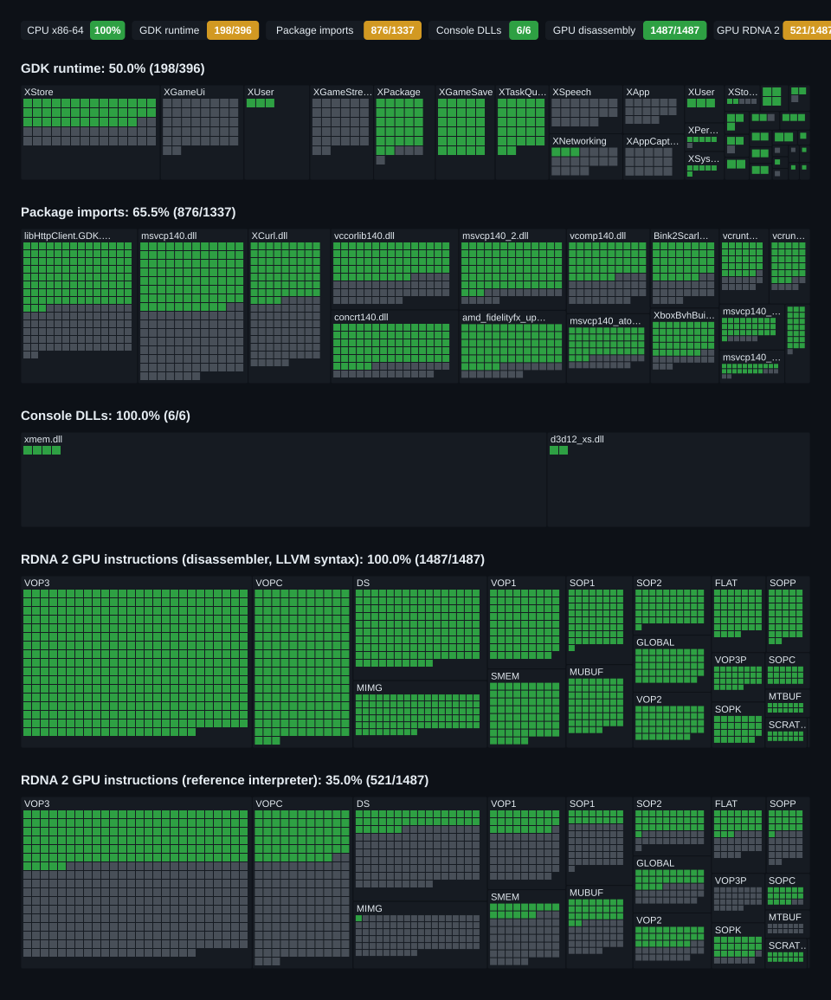
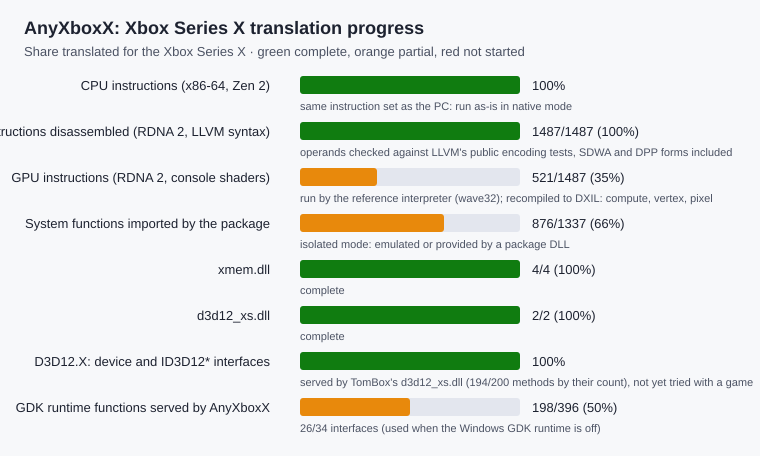

# AnyXboxX — émulateur Xbox Series X (prototype)

[](https://discord.gg/TcX42vRyPU)

[English](../../README.md) · **Français**

> [!NOTE]
> **Où on en est (27/11/2026)**
>
> - ✅ **Le jeu tourne.** GTA VI 1.0.2.1 (build Xbox Series) démarre, joue ses cinématiques et arrive dans le monde ouvert grâce à VIctory, la copie dans `third_party/victory`.
> - 📈 **Environ 24 fps médians dans le monde en Full HD, 30 fps (le plafond du jeu) dans les scènes jusqu'à environ 4 000 draws** (mode Series X, RTX 4070 SUPER et i7-13700KF, cache chaud, une partie de 14 minutes par le lanceur le 27/11/2026), environ 20 en 4K, contre 14,2 sur la base précédente. `third_party/victory` repose sur [Vice-Tay](https://github.com/TaynanGT/Vice-Tay), qui garde les tampons du jeu sur la carte, prépare l'image suivante pendant que la carte travaille et répartit le travail sur plusieurs threads ; à partir de 16 processeurs logiques, le lanceur donne plus de place à ces threads (19,6 -> 23,8 fps médians). Les scènes lourdes (7 000 à 11 000 draws) descendent encore à 10-18 fps. Mesures antérieures : [docs/fr/avancee.md](../fr/avancee.md).
> - 🖥️ **Le Full HD, pas la 4K, pour gagner des fps.** Le lanceur joue maintenant en 1920x1080 par défaut : le jeu rend en 1280x720 en interne au lieu des 2560x1440 de la 4K qu'une Series X a écrite dans ses réglages. Avec `anyxboxx run`, ajoutez `--override VICTORY_OUTPUT=1920x1080`.
> - 🎮 **Jouable à la souris et au clavier** : cliquez sur l'image du jeu pour piloter la caméra à la souris (F9 la rend), bouton droit pour viser, bouton gauche pour tirer. L'overlay (F10) affiche les fps, le CPU par cœur, le GPU, la RAM, la VRAM et l'occupation de chaque groupe de threads de VIctory.
> - ⛔ **Limites connues** : le ray tracing est coupé, donc les zones d'intérieur et à l'ombre sont sombres ; quelques graphismes manquent ; le jeu se bride lui-même à 30 fps ; il utilise 20 à 25 Go de RAM, 32 Go sont conseillés.

AnyXboxX exécute des exécutables GDK Xbox (PE32+ x86-64) sous Windows. Il est spécialisé sur un seul build, **Grand Theft Auto VI pour Xbox Series, version 1.0.2.1**, et ne traduit que ce dont ce jeu a besoin : les fonctions système de la console, les shaders RDNA 2 et les appels Direct3D 12.x. Le rendu vient de [VIctory](https://github.com/Marvisak/VIctory) (Marvisak, GPL-3.0 ou ultérieure), copié dans `third_party/victory` avec les pull requests de ses contributeurs, crédités dans [THIRD_PARTY.md](../../THIRD_PARTY.md).

Ce dépôt ne contient ni fichier de jeu, ni clé, ni exécutable, et n'explique pas comment les obtenir. Page d'état en ligne, avec l'espace disque à prévoir : **[loopersalty.github.io/AnyXboxX](https://loopersalty.github.io/AnyXboxX/)**.

## Configuration requise

- Windows 10 ou 11, 64 bits, avec un processeur compatible AVX2.
- Une carte graphique Direct3D 12 avec le shader model 6.6 et les mesh shaders : GeForce RTX série 20 ou plus récente, ou Radeon RDNA 2 ou plus récente. **Le projet est centré sur NVIDIA** : toutes les mesures et les réglages du lanceur visent les cartes NVIDIA (RTX 4070 SUPER). Les cartes AMD marchent aussi, mais moins bien (moins de fps, plus de défauts graphiques), et reçoivent moins d'attention. Une carte de 12 Go manque de mémoire pour les textures ; le lanceur propose un préréglage pour les cartes de 8 et 12 Go.
- 32 Go de RAM conseillés, et plus de 30 Go libres sur le disque système (le cache des shaders grossit en jouant).
- Votre propre copie du build Xbox Series 1.0.2.1 : un dossier qui contient `game_scarlett_master.exe`. Il n'est pas fourni.
- [Rust](https://rustup.rs/) et Visual Studio 2022 ou 2026 Build Tools avec la charge de travail « Développement desktop en C++ ». VIctory est compilé depuis les sources au premier lancement.

## Lancer le jeu

### Avec le lanceur graphique (recommandé)

1. Clonez le dépôt : `git clone https://github.com/LooperSalty/AnyXboxX.git`. VIctory est déjà dans `third_party/victory`.
2. Récupérez `anyxboxx-launcher.exe` dans la [version launcher-v0.2.0](https://github.com/LooperSalty/AnyXboxX/releases/tag/launcher-v0.2.0) et placez-le dans le dossier cloné, ou compilez-le avec `cargo build --release -p anyxboxx-launcher`.
3. Double-cliquez sur le lanceur. Sur la page **Dossier du jeu**, choisissez le dossier qui contient `game_scarlett_master.exe`, puis appuyez sur **PLAY**. Le premier démarrage compile VIctory et chauffe le cache des shaders ; jugez la vitesse à partir du second.

Le guide complet, avec les options, les fichiers écrits et le dépannage, est dans [docs/fr/lanceur.md](../fr/lanceur.md) (en anglais : [docs/launcher.md](../../docs/launcher.md)).

### En ligne de commande

```powershell
cargo build --release -p anyxboxx
.\target\release\anyxboxx.exe run --game-dir <dossier du jeu>
```

`anyxboxx run` lance le jeu avec les mêmes réglages mesurés que le lanceur. Guide complet : [docs/fr/lancer-gta6.md](../fr/lancer-gta6.md) (en anglais : [docs/running-gta6.md](../../docs/running-gta6.md)).

## Avancée de la traduction



Régénérer : `scarlett.py --carte <dossier du paquet> docs/images/carte-avancee.svg`.



- **Instructions CPU : 100 %.** La Series X utilise un AMD Zen 2 en x86-64, le même jeu d'instructions qu'un PC : le code du jeu tourne tel quel.
- **Instructions GPU : 89 %.** 1 330 des 1 490 encodages RDNA 2 tournent dans l'interpréteur de référence, et le recompilateur RDNA 2 → DXIL dessine déjà un premier shader de sommet et de pixel avec D3D12.
- **Fonctions système : 66 %** des 1 337 fonctions importées par les DLL du paquet de test sont résolues.
- **Runtime GDK : 210 fonctions sur 396** sont écrites dans AnyXboxX, en Rust et en C++ : la file de tâches, l'utilisateur hors ligne, l'identité de la Series X, les sauvegardes, le paquet, le Store hors ligne et les invitations. Les autres interfaces sont servies par le runtime GDK de Windows s'il est installé.

Le graphique est régénéré par `scarlett.py --traduction <dossier du paquet> docs/images/traduction.svg`.

## Avancement du projet

| Étape | État |
|---|---|
| Lanceur graphique Rust `anyxboxx-launcher` et `anyxboxx run` : vérification de la machine, compilation de VIctory, chauffe du cache des shaders, lancement du jeu | ✅ fait |
| Le build Xbox Series 1.0.2.1 tourne avec VIctory : démarrage, cinématiques, monde ouvert (environ 24 fps médians dans le monde en Full HD, plafond de 30 fps atteint, environ 20 en 4K, mode Series X, RTX 4070 SUPER) | 🟡 en cours |
| Émulation de la mémoire unifiée : copies et relectures entre la mémoire de la console et celle du PC (principal coût du CPU) | 🟡 en cours |
| Éclairage en ray tracing (le constructeur de structures BVH est coupé) | ⏳ à faire |
| Interrupteur NVIDIA Smooth Motion dans le lanceur, préréglages pour les cartes de 8 et 12 Go | ✅ fait |
| Full HD par défaut, groupes de threads dimensionnés selon les cœurs du processeur, caméra à la souris, overlay avec CPU par cœur et groupes de threads | ✅ fait |
| DLL du runtime en Rust : `xmem`, `kernelx`, `d3d12_xs`, `anyxboxx_tls`, `XCRDAPI` ; `xgameruntime` porté et vérifié contre la DLL C++, qui reste celle livrée | 🟡 en cours |
| Runtime GDK : 210 fonctions sur 396 écrites dans AnyXboxX ; les autres déléguées au runtime GDK de Windows, nommées par la trace | 🟡 en cours |
| `XTaskQueue`, `XAsync`, `XThread`, `XUser`, `XSystem`, `XGameSave`, `XPackage`, `XStore` écrits par AnyXboxX | ✅ fait |
| D3D12.X : `D3D12XboxCreateDevice`, interfaces `ID3D12*` de la console, servies par le `d3d12_xs.dll` en Rust de TomBox (MIT) | 🟡 en cours |
| Désassembleur RDNA 2 : 1 490 mnémoniques, vérifié contre 38 999 encodages LLVM publics | 🟡 en cours |
| Opérandes du désassembleur RDNA 2 identiques au texte de LLVM (scalaire, VOP1/VOPC, DS, EXP) | ✅ fait |
| Recompilateur de shaders RDNA 2 → DXIL : shaders de sommet et de pixel dessinés avec D3D12, textures avec `image_sample`, identiques à l'interpréteur de référence sur le GPU et sur WARP | 🟡 en cours |
| Programmes de calcul en wave64 sur les GPU à vagues de 32 voies | 🟡 en cours |
| Cache des shaders : shaders traduits compilés une fois en DXIL, puis relus depuis le disque | 🟡 en cours |
| Retarget DXIL console → DXIL PC (Xbox2Windows, MIT) | ✅ fait |
| Textures console en Rust : décodage BC7 et tuilage GFX10 `SW_4K_S`, portés depuis Xbox2Windows (MIT) | 🟡 en cours |
| Audio XMA2 de la console décodé en WAV par le portage Rust de FFmpeg par TomBox (LGPL) | 🟡 en cours |
| Exceptions SEH x64 (`.pdata`), chargement dynamique d'une DLL à l'exécution (`LoadLibrary` + `DllMain`) | ⏳ à faire |
| Graphismes D3D12.X vers Direct3D 12 / Vulkan | ⏳ à faire |
| 1900+ tests automatisés | ✅ fait |
| Vérifications des pull requests : lint et synchronisation des README anglais et français (lignes, images, nombre de tests) | ✅ fait |

## Recherche et historique

- [docs/fr/avancee.md](../fr/avancee.md) : mesures du jeu, et résultats antérieurs sur les DLL console du paquet de test.
- [docs/fr/jeu-de-test.md](../fr/jeu-de-test.md) : les jeux de test libres (SimpleTriangle, testgdk de SDL3) du premier prototype, et les outils Python qui génèrent encore les graphiques d'avancement.
- [docs/fr/jour-j.md](../fr/jour-j.md) : le rapport de premier lancement pour un exécutable console (`jour_j.py`).
- [Architecture matérielle de la Xbox Series X](../../docs/research/xbox-series-x-architecture.md), [émulateurs et couches de compatibilité existants](../../docs/research/state-of-the-art.md), [TomBox](../../docs/research/tombox.md), [Xbox2Windows](../../docs/research/xbox2windows.md).
- [État du portage en Rust](../fr/rust-full-status.md).

## Tests

```powershell
python -m venv .venv
.\.venv\Scripts\python.exe -m pip install -r requirements.txt -r requirements-dev.txt
.\.venv\Scripts\python.exe -m pytest
```

Les tests qui demandent le runtime C++ sont sautés tant qu'il n'est pas compilé. Les tests GPU demandent `dxc` et le lanceur de GPU ; sans GPU, ils utilisent WARP.

## Contribuer

La branche `main` est protégée : chaque contribution passe par une pull request relue, et les tests doivent passer. Les bogues et les fonctions à émuler se signalent dans les issues. Les règles complètes sont dans [CONTRIBUTING.md](../../CONTRIBUTING.md).

Discussion, aide et retours de test : [Discord](https://discord.gg/TcX42vRyPU)

## Licence

AnyXboxX est distribué sous la [GNU GPL 3.0 ou ultérieure](../../LICENSE). Les parties tierces gardent leur propre licence : le module `Task` de libHttpClient (MIT, `runtime/third_party/libhttpclient-task`) et les tables RDNA 2 générées à partir des tests d'encodage publics de LLVM (Apache 2.0 avec exception LLVM, `PrototypeScarlett/emu/rdna2_ops.py` et `rdna2_shapes.py`).

Composants tiers et crédits : [THIRD_PARTY.md](../../THIRD_PARTY.md).
